# Design brief — saras

**For:** Claude Design · **From:** Enspirit · **Date:** 22 November 2026

## 1. The ask

saras works and its screens are complete, but it looks like what it is: an interface assembled by engineers from a small, strict design system. We ask for two things:

1. **Better UX on the existing screens.** Same features, better arranged: clearer hierarchy, fewer steps, the important action where the eye is. The reply screen first.
2. **A more professional overall design.** A visual language a law firm, an accountancy or a consultancy would trust with its client email: typography, colour, density, depth, icons, states.

What we do **not** ask for: new features, a new front-end stack, or a design that only works for the default brand. Section 4 lists the constraints the result must live within.

Companion document: [`../user-stories.md`](../user-stories.md) — one story per feature (`US-xx`), with the behaviour as built. Screens below reference them.

## 2. The product in one page

saras is a self-hosted web tool to answer email with the help of AI, without handing the AI the keys.

- **Who:** small professional teams (5–50 people) handling client email. Members answer; one or two administrators set the tool up. Not technical users.
- **Core loop:** connect a mailbox and choose one folder to watch → emails that expect a reply land in **To handle** → open one, write a reply or a few notes → optionally ask the AI to check typos, improve the style, or write the reply with one of the organisation's prompts → review, edit → **Send** or **Save as draft**. Nothing is ever sent without explicit validation.
- **What it sells:** privacy. Zero data retention is enforced on every AI request, the AI is sent as little as possible, content is erased after 30 days, and the user stays in control of every word. The design must make that feel true: calm, precise, transparent about what the AI did and what it was shown.
- **Where it runs:** on the customer's own server, usually under the customer's own brand (name, logo, colours, fonts). English by default, French provided.

**Personas** (detail in the user stories): *Member* (answers email, all day, mostly on a laptop, sometimes on a phone) · *Administrator* (a member who also invites people, connects shared mailboxes, writes prompts) · *Invited person* · *Operator* (hosts and brands the installation; works in files).

**Tone to aim for:** a quiet professional tool — closer to a good mail client or a document editor than to an "AI product". No sparkle icons, no gradients, no chat bubbles. The AI is an assistant in the margin, not the hero.

## 3. What to keep

- The two-pane mailbox (list, reading pane) and the four boxes: To handle / No reply needed / Replied / Ignored.
- **One** reply area, where the user writes whatever they want, and three optional kinds of AI help acting on it. This was a deliberate simplification; do not split it back into "notes" and "draft".
- Plain, complete sentences in the interface. The wording is careful; it may be shortened, not made vaguer.
- The visible privacy guarantees (the ZDR assurance, Settings → Privacy, "the email received is not sent to the AI" on typos and style).
- Theming by a dozen brand variables, light and dark derived automatically.

## 4. Constraints the design must respect

### Technical

| Constraint | Consequence for the design |
| --- | --- |
| **No framework, no bundler.** Plain CSS files and TypeScript functions that build DOM nodes. | No component library to adopt. Everything proposed must be expressible as CSS plus a small function. Keep the component count reasonable. |
| **Strict layering, enforced by tests**: tokens → base → atoms → molecules → organisms → pages. | Deliver changes *per tier* (section 5). Pages contain no class names and no HTML elements: anything visual is a component. |
| **Literals only in `tokens.css`.** A colour or a font value written anywhere else fails the build. | Every colour, size, shadow, radius in the design must be a token. New tokens are welcome; one-off values are not. |
| **Brandable.** Components read semantic tokens (`--color-*`), never brand inputs (`--brand-*`). A brand sets ~12 inputs; the rest is derived with `color-mix()` and `light-dark()`. | The design must hold when accent, canvas, ink, fonts and radius change. Show it with the default brand **and** the example brand (green accent, serif headings, 2 px radius — screenshot 40). Status colours (ok / warn / danger) keep their meaning across brands. |
| **Light and dark** from the same tokens, following the system. | Every screen in both. |
| **Content-Security-Policy `default-src 'self'`.** | No web-font or icon CDN, no inline `style` attributes. Fonts and icons are self-hosted files (open licence — the project is MIT) or inline SVG built by a component. The default brand currently uses the system font stack. |
| **All wording in translation files** (English, French), ICU format; a test forbids text in code. | Text may be reworded or added, as keys. French runs 20–30 % longer: buttons and labels must not be sized for English. |
| **One breakpoint today: 860 px.** Below it the navigation becomes a top bar and list / detail alternate. | Mobile is a real use (US-41). More breakpoints are fine. |
| **Rich text editor is Squire** (bold, italic, underline, lists, link, clear). Received emails are plain text. Replies carry no attachments. | Design the toolbar we have; do not design image or attachment handling. |

### Product

- No new features. Restructuring existing ones — moving an action, turning a permanent form into a step, replacing a browser dialog with a designed one — is exactly what we want.
- Accessibility: WCAG 2.1 AA contrast in both schemes, visible focus, everything reachable by keyboard. Current markup is semantic (labels wrap their controls, `aria-current`, `aria-pressed`, a live region for notifications); keep that.
- Dense enough for someone who answers forty emails a day; not so dense it stops feeling calm.

## 5. The design system as it stands

Live version: **`/styleguide.html`** on any running instance renders every token and component with the brand in place (screenshot [29](screenshots/29-styleguide.png) — a long page, open it at full size).

### Structure

```
public/design/                      web/ui/
  index.css      @layer order         dom.ts        h(): the one element-creation function
  tokens.css     every literal        atoms.ts
  base.css       element defaults     molecules.ts
  atoms.css                           organisms.ts
  molecules.css                       brand.ts      loads name, tagline, logo
  organisms.css                       sanitize.ts
public/brand/                       web/
  theme.css      the ~12 brand inputs   app.ts        every screen of the application
  brand.json     name, tagline, logos   styleguide.ts the living style guide
```

CSS cascade layers (`@layer tokens, base, atoms, molecules, organisms`) make the hierarchy effective; `theme.css` is loaded outside any layer and wins without `!important`.

### Tokens (`public/design/tokens.css`)

Three tiers: **brand inputs** → **semantic tokens** → **component tokens** declared on the component itself (`--btn-bg`, `--card-padding`, `--badge-text`…).

| Group | Tokens | Current values |
| --- | --- | --- |
| Brand inputs | `--brand-accent`, `--brand-on-accent`, `--brand-canvas`, `--brand-ink` (+ `-dark` of each), `--brand-font-body`, `--brand-font-heading`, `--brand-radius`, `--brand-color-scheme`, `--logo-height` | accent `#1f5fbf` / `#7fb0ff`, canvas `#f6f5f1` / `#15171b`, ink `#1d1f24` / `#e8e9ec`, system font stack, radius 8 px |
| Surfaces and text | `--color-bg`, `--color-surface`, `--color-text`, `--color-text-muted`, `--color-border`, `--color-border-strong`, `--color-hover` | surface is white (light) or canvas + 7 % white (dark); muted, borders and hover are mixes of ink into canvas (64 %, 13 %, 45 %, 7 %) |
| Accent | `--color-accent`, `--color-on-accent`, `--color-accent-soft`, `--color-focus` | soft = 12 % accent on surface |
| Status | `--color-ok`, `--color-warn`, `--color-danger`, `--color-on-danger`, and a `-soft` of each | `#14744a`, `#8a5200`, `#b3261e` (light) |
| Overlay | `--color-overlay-bg`, `--color-overlay-text`, `--shadow-overlay` | inverted ink / canvas; the only shadow in the system, used by the toast |
| Type | `--font-body`, `--font-heading`, `--font-mono`; `--text-xs` 12, `-sm` 13, `-md` 15, `-lg` 18, `-xl` 22; `--leading` 1.5, `--leading-tight` 1.25; weights 400 / 600 / 700 | five sizes, three weights, no display size |
| Space | `--space-1` … `--space-6` = 4, 8, 12, 16, 20, 24; `--space-8` = 40 | 4 px grid, no 32 |
| Shape | `--radius-md` (= brand radius), `--radius-sm` (75 %), `--radius-pill`, `--border-width` 1 px, `--focus-width` 2 px | |
| Layout | `--nav-width` 230, `--list-width` 380, `--content-width` 860, `--auth-width` 400, `--z-sticky`, `--z-overlay` | |

Missing today, and probably needed: an elevation scale, motion tokens (duration, easing), control heights / sizes, an icon size, a larger type step, a secondary surface (sunken / raised).

### Components

| Tier | Component | Variants and notes |
| --- | --- | --- |
| **Atoms** (`atoms.ts`, `atoms.css`) | `Button`, `ButtonLink` | default, primary, danger (red text only), link, tool (toolbar, with pressed state); `block`; disabled. One size. No icon slot, no loading state. |
| | `Input`, `Select`, `Textarea`, `Checkbox` | One `.input` style for the three; native select arrow and native checkbox. No error state. |
| | `Badge` | accent, ok, warn, danger, neutral — pill. |
| | `Notice` | info, ok, warn, danger — tinted block, text only. |
| | `Text`, `Muted`, `Small`, `Strong`, `Code`, `Link`, `Heading` (1–3), `List`, `Prose` (plain-text mail body), `RichText` (sanitised HTML reply) | |
| | `BrandMark` | Name as text, or logo image with a dark variant; `large` on the sign-in panel. |
| | `Spacer` | Pushes what follows to the end of a row. |
| **Molecules** (`molecules.ts`, `molecules.css`) | `Field`, `CheckField`, `FormRow`, `Form`, `Actions`, `Block` | Label + control + hint; sizes fill / narrow / fit. |
| | `Card`, `CardSection` | Bordered white surface with a title (h2) and badges; titled sub-part (h3). The only container. |
| | `PageHeader`, `EmptyState` | Title + actions; centred muted sentence. |
| | `NavItem`, `Assurance` | Entry with count and current state; the green ZDR block. |
| | `EmailListItem`, `Message` | Sender / date / subject / snippet / badges; scrolling mail body (max 420 px). |
| | `RichEditor` | Squire surface + text-labelled toolbar. |
| | Toast (`createToast`) | One at a time, bottom centre; plain or error. |
| | `Swatch` | Style guide only. |
| **Organisms** (`organisms.ts`, `organisms.css`) | `AuthPanel` | Sign-in, sign-up, invitation. |
| | `AppShell` | Side navigation (brand, two sections, assurance, user, sign out) + main. |
| | `Page` | Scrolling column of cards, max 860 px. |
| | `Mailbox`, `ReadingHeader` | List + reading pane; subject, meta lines, triage verdict. |

**There is no:** icon, dialog / confirmation, menu or popover, tabs, tooltip, avatar, table, spinner or skeleton, inline form error, tag input, banner. Browser-native `confirm()` and `prompt()` stand in for dialogs.

## 6. Screens today

Twenty captures (the numbers are not contiguous), taken on the repository's demo stack (fictitious organisation and emails, stand-in AI), 1440 × 900 at 2×, English, default brand unless stated. "Full" captures are stretched so that the whole scrolling content shows; the others are what a user sees on arrival.

### 6.1 Priority 1 — reading and replying (US-25, US-30 – US-40)

This is where members spend their day, and where the design matters most.

| Screen | Capture |
| --- | --- |
| Email open, as it appears at 1440 × 900 | 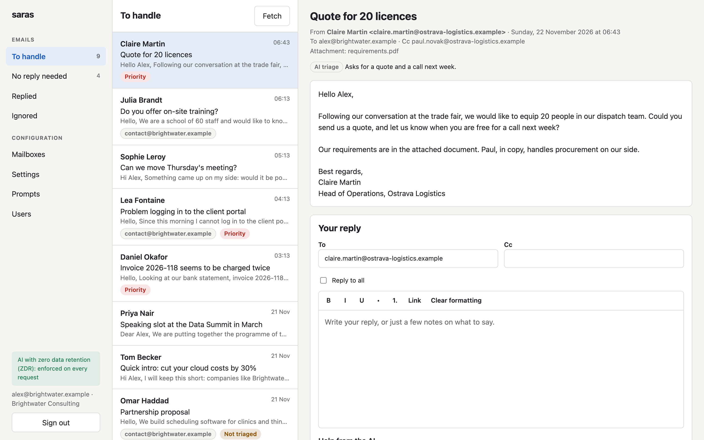 |
| Email open, whole pane | 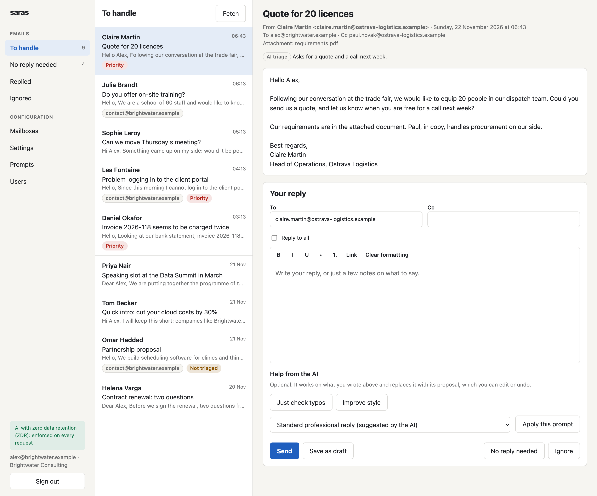 |
| After "Apply this prompt" | 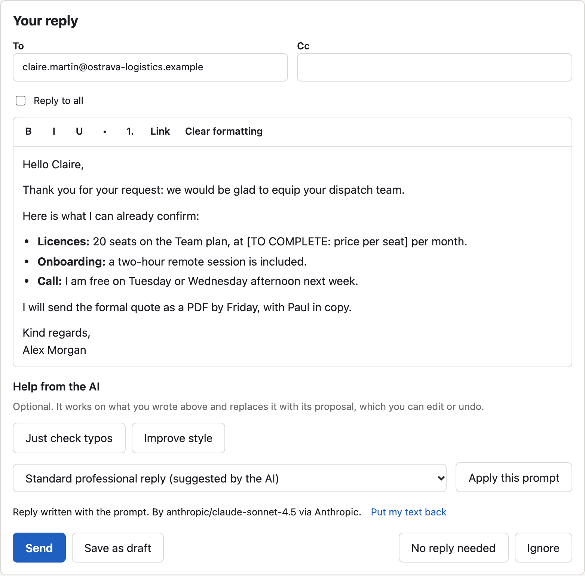 |
| Proposal edited: the "why" field appeared; Reply to all ticked | 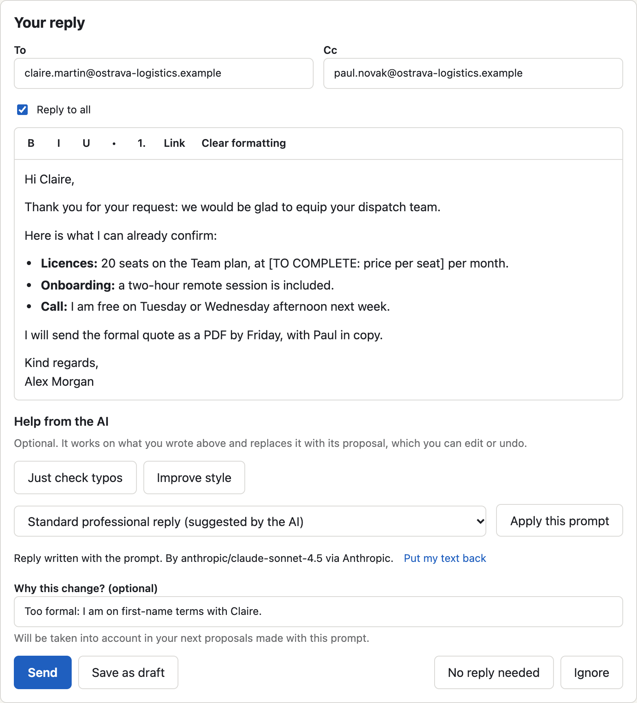 |
| Error: help asked with nothing written | 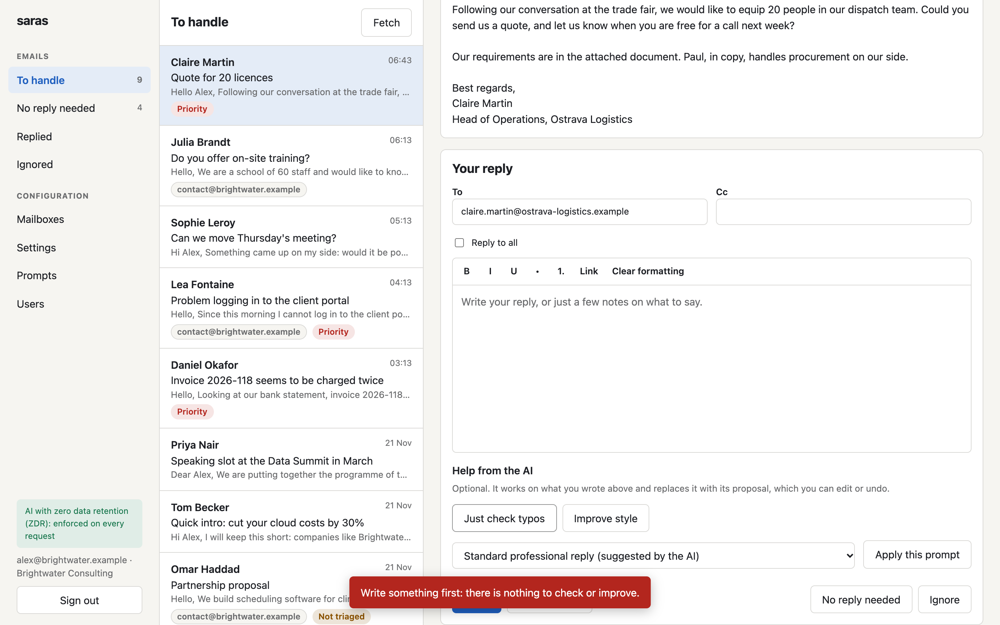 |

**What we see**

1. **The actions are below the fold.** At 1440 × 900, for a nine-line email, the editor starts at about 600 px and "Help from the AI" begins exactly at the bottom edge. The AI buttons, **Send**, **Save as draft**, **No reply needed** and **Ignore** all require scrolling (Send is at ~1,130 px). Dismissing an email that needs no reply means scrolling past an empty editor.
2. **Triage actions live inside the reply card.** "No reply needed" and "Ignore" are decisions about the *email*, taken before writing anything; they sit at the bottom right of "Your reply", after the send buttons.
3. **The AI help has no shape.** Two buttons, then a select with a button, then a line of small text. The three actions are equals in the product but look like two things plus a form. The suggested prompt is announced inside a native `<select>` option ("… (suggested by the AI)").
4. **A proposal arrives silently.** The editor's content is replaced with no transition, no mark of which text is the AI's, and the only trace is one small line: "Reply written with the prompt. By anthropic/claude-sonnet-4.5 via Anthropic." The undo ("Put my text back") is a link at the end of that line.
5. **Placeholders are invisible.** `[TO COMPLETE: price per seat]` is plain text inside the proposal — the one thing the user must not miss before sending.
6. **"Why this change?" appears unannounced** between the AI block and Send once the proposal is edited. Its value (it teaches the user's next proposals) and its audience (administrators can read it) are not obvious where it shows.
7. **Recipients are two raw text inputs** with comma-separated addresses, and "Reply to all" is a checkbox on its own line. They take the best position in the card for something rarely changed.
8. **Sending is confirmed by a browser `confirm()`**, and a link is created through a browser `prompt()`. Neither can be styled, branded or translated consistently, and they are the last thing the user sees before an email leaves.
9. **The toolbar is letters**: `B I U • 1. Link Clear formatting`.
10. **Feedback is thin.** Loading is a button whose label becomes "Working…"; success and errors are one toast at the bottom centre, away from where the user is looking, gone in 3.5 s (8 s for errors).
11. **The reading header is three lines of grey text** (from, to / cc, attachments) with a full weekday date; attachments are a sentence. The triage verdict — who sorted it and why — is a small badge and a sentence.

### 6.2 Priority 2 — the boxes and the shell (US-20 – US-24, US-39, US-40)

| Screen | Capture |
| --- | --- |
| To handle | 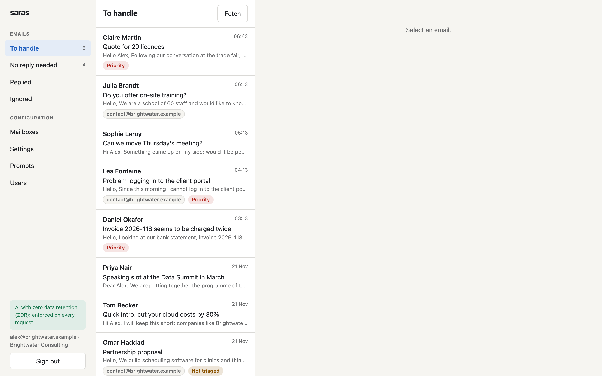 |
| Replied: a sent reply (edited, with its reason) | 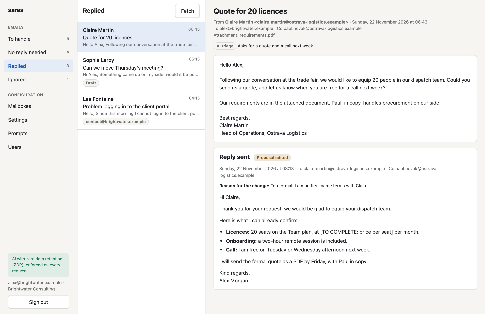 |
| No reply needed: set aside by a rule | 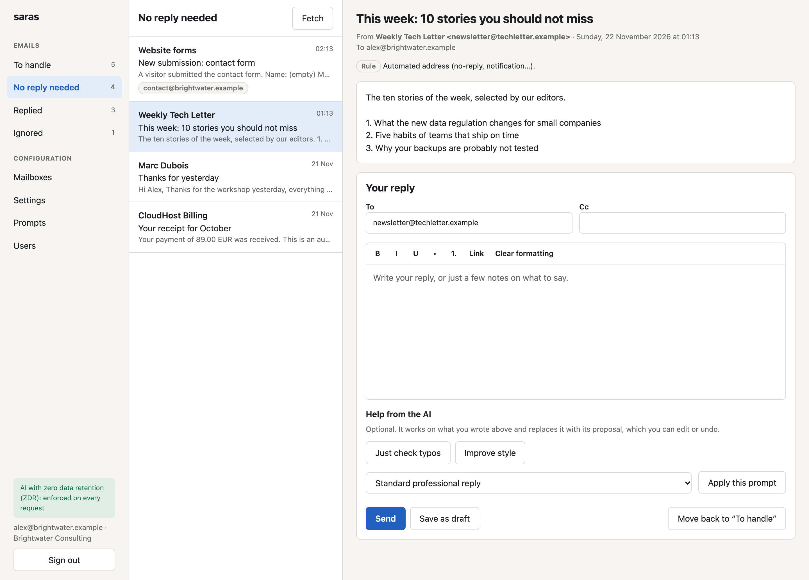 |

**What we see**

1. **List rows have little hierarchy.** Sender is bold; subject and snippet differ by a shade. Badges take a row of their own, so rows are 90–115 px tall and eight fit on a 900 px screen. The shared mailbox is shown as its full address in a pill on every row.
2. **"Priority" and "Not triaged"** are the only signals of what to do first, and they look like any other badge.
3. **The reading pane, empty, is one grey sentence** ("Select an email.") in a large blank area. So is every empty box. The first-run empty state mentions Mailboxes without linking to it.
4. **"Fetch"** is the only control of the list, with no sign of when mail was last fetched.
5. **Emails that need no reply still show the full reply editor** (screenshot 20: a newsletter, with "To: newsletter@…" prefilled), with the one useful action — "Move back to To handle" — at the very bottom.
6. **In Replied, the facts are in grey small print** and "Proposal edited" uses the warning colour for something that is not a problem.
7. **Navigation.** The four boxes and the four configuration pages are the same kind of entry. The signed-in user is a line of small grey text; "Sign out" is a full-width button — the largest control in the sidebar. The ZDR assurance, styled as a success notice, reads as a status message rather than a standing guarantee.
8. **People are email addresses everywhere** — in lists, in "by …", in Users.

### 6.3 Priority 3 — arriving and connecting (US-01 – US-04, US-10 – US-16)

| Screen | Capture |
| --- | --- |
| Sign in | 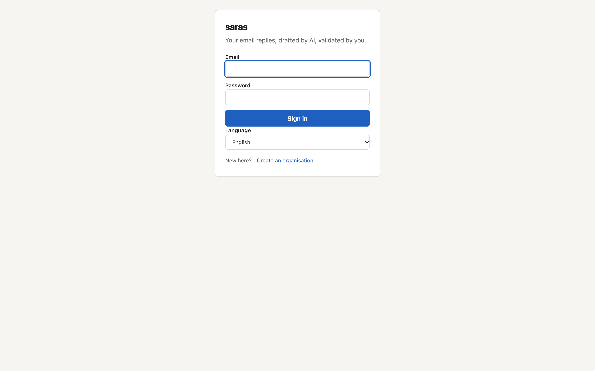 |
| Just connected: choose the folder to watch | 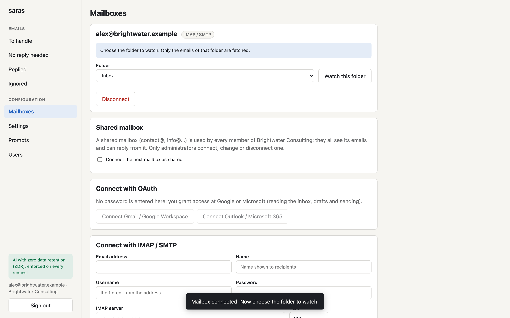 |
| Mailboxes, one personal and one shared | 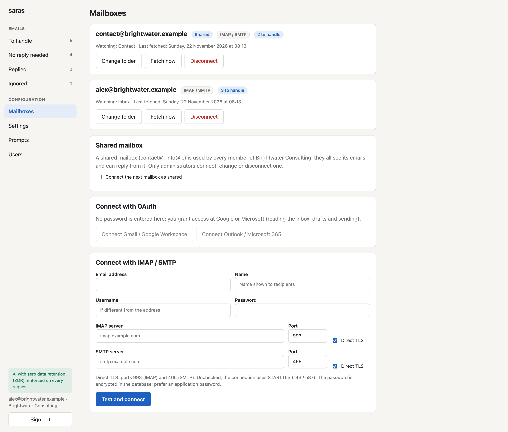 |

**What we see**

1. **The sign-in panel is stuck to the top of the page**, not centred (a layout bug: the panel's container has no height to centre within). The language picker sits between the submit button and the footer, its label touching the button.
2. **The first impression carries no identity**: a wordmark in the system font and a tagline. The default brand has no logo. This screen is where a branded installation should look most like its owner.
3. **Onboarding is a page, not a path.** After signing up, the user lands on Mailboxes: a notice, then three cards — a checkbox ("Connect the next mailbox as shared"), two OAuth buttons, a ten-field IMAP form. Then a toast says to choose a folder; then they must find their way to the inbox. There is no sense of "step 1 of 3".
4. **"Shared" is a mode set in one card that changes what a button in another card does.** It is easy to connect a mailbox as shared by accident, or personal by accident.
5. **Unavailable OAuth buttons are greyed with the reason in a tooltip only.**
6. **The IMAP form is the technical truth**, shown to everyone: servers, ports, "Direct TLS", STARTTLS. It stays fully displayed on the page forever, below the connected mailboxes.
7. **On a connected mailbox, "Change folder", "Fetch now" and "Disconnect" are three equal buttons.** Dates are spelled out in full ("Sunday, 22 November 2026 at 08:09").

### 6.4 Priority 4 — administration and settings (US-05 – US-07, US-50 – US-53, US-60 – US-65)

| Screen | Capture |
| --- | --- |
| Prompts | 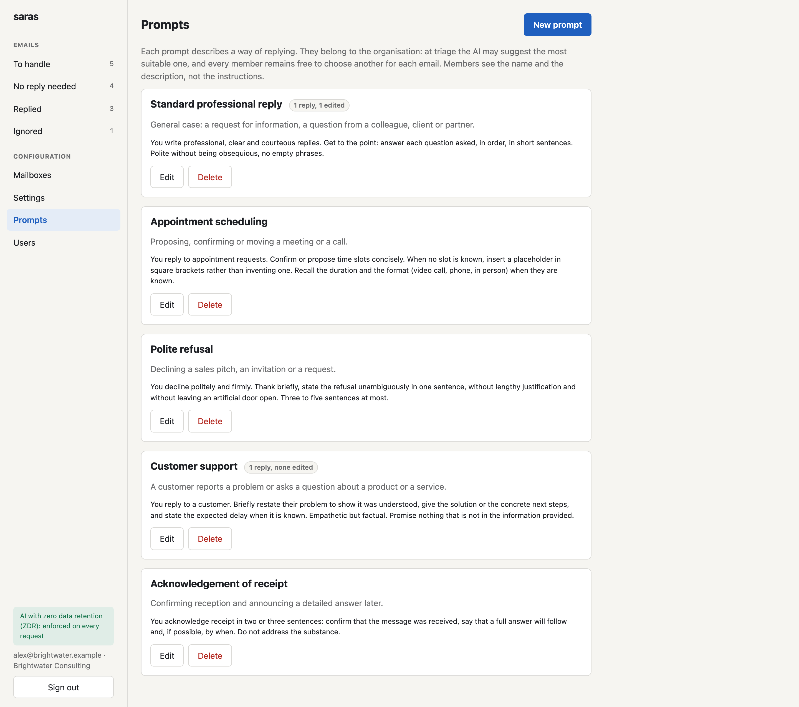 |
| Edit a prompt, with members' corrections | 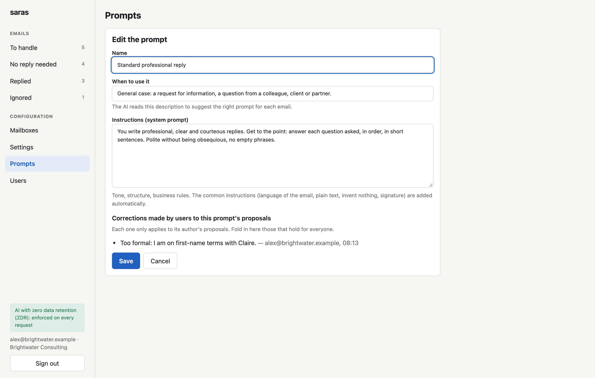 |
| Users and invitations | 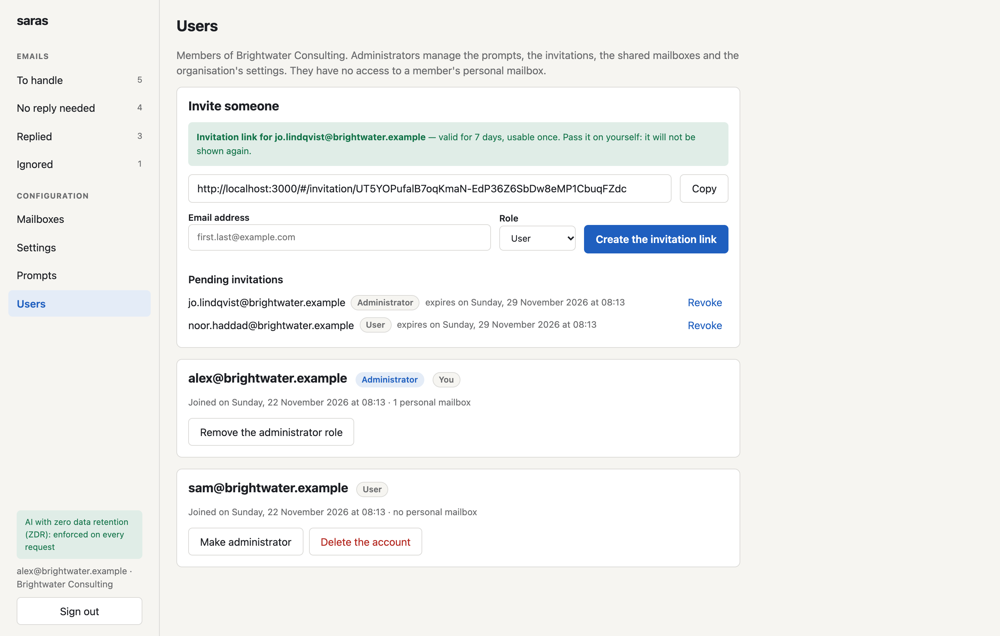 |
| Settings (administrator) | 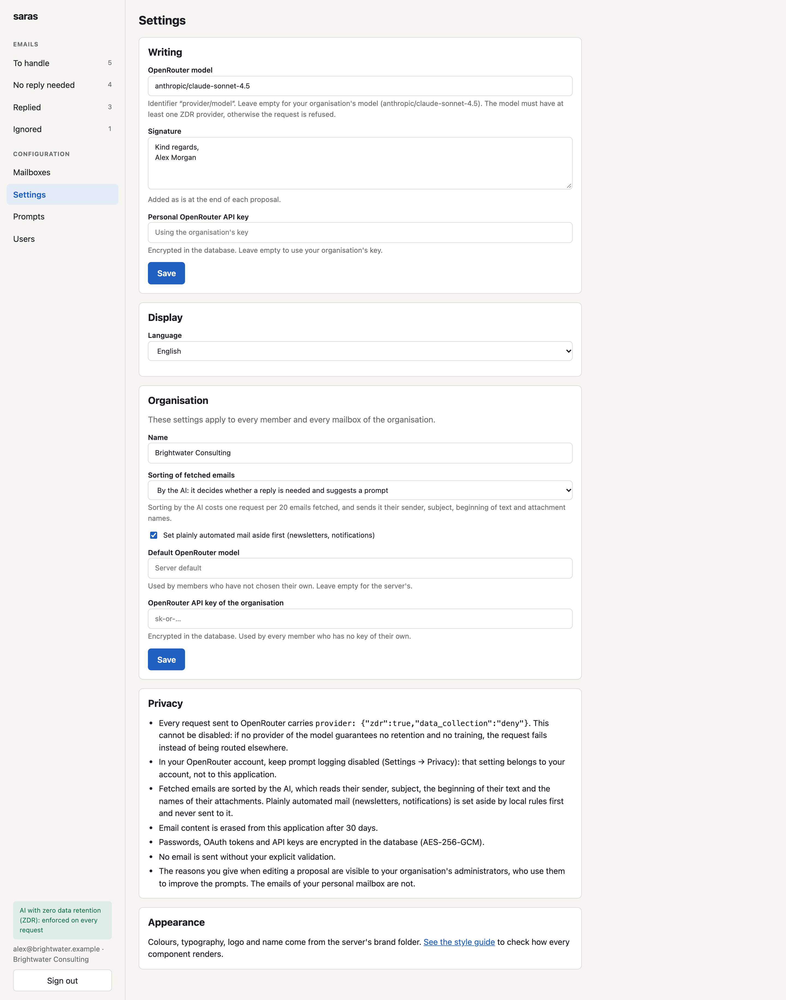 |

**What we see**

1. **Every page is a stack of identical white cards** in an 860 px column pinned left; on a wide screen the right 40 % is empty. Card titles (18 px bold) compete with the page title (22 px bold).
2. **Prompts:** each card prints the whole instructions; "Edit" and "Delete" repeat on every card with equal weight. Usage ("1 reply, 1 edited") — the signal that a prompt needs attention — is a grey pill. The editor replaces the list without a URL or a way back other than Cancel, and the corrections it should prompt the administrator to act on are at the bottom, under the form.
3. **Users:** one card holds the fresh invitation link, the invitation form and the pending invitations. Members are cards with sentence-long buttons ("Remove the administrator role"). A list or a table would say more in less space.
4. **Settings mixes three audiences on one page:** my writing (model, signature, key), my display (language), the organisation (administrators), then Privacy (a bullet list of seven dense sentences with a JSON snippet) and Appearance (one sentence). There are two "Save" buttons. "OpenRouter model" is a free-text identifier.
5. **Privacy is the product's promise and is presented as fine print.**
6. **Destructive actions** (Delete, Disconnect, Delete the account) are red text on a normal button, next to harmless ones, confirmed by a browser dialog.

### 6.5 Small screens (US-41)

| To handle | Email open, whole pane |
| --- | --- |
| 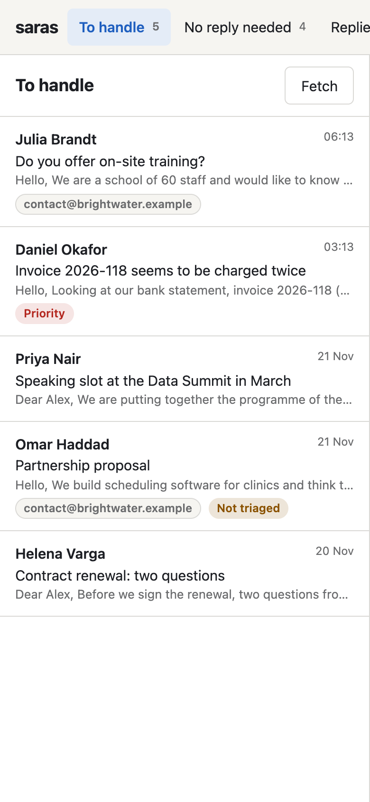 | 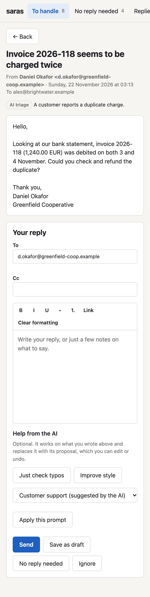 |

**What we see:** the navigation becomes a single scrolling row — "Replied" is cut at the edge, the configuration pages and Sign out are off-screen with nothing to say they exist, and the signed-in user is hidden. The editor toolbar wraps onto two lines. The reply flow is one very long scroll (about 1,540 px at 390 wide) with Send at the very end.

### 6.6 Dark scheme and another brand (US-80 – US-82)

| Screen | Capture |
| --- | --- |
| Dark: email open | 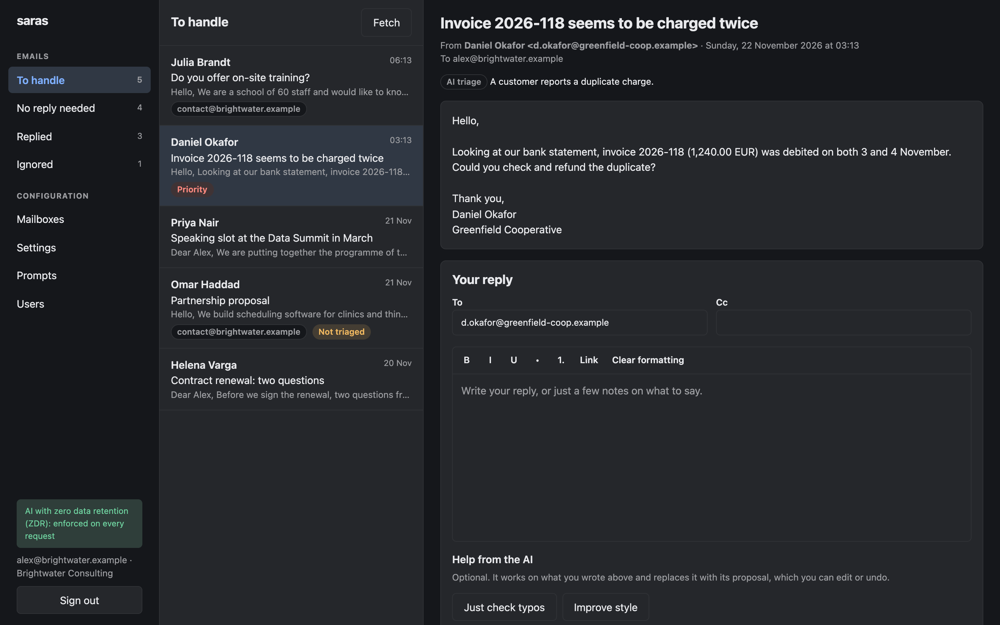 |
| Example brand: email open | 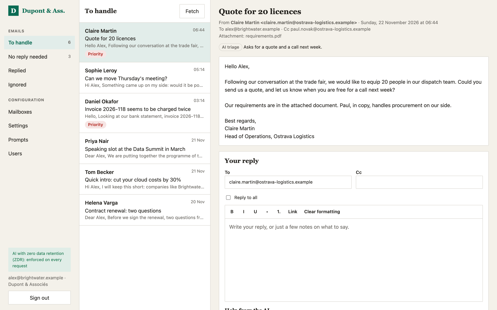 |

**What we see:** both work, which is the point of the token system. In dark, surface and background are very close and the cards barely separate. With the example brand, only headings, accent and radius change — the layout and every grey are identical, so a brand reads as a tint rather than an identity.

## 7. Across all screens: why it does not look professional yet

1. **No icons at all.** Every control is a word; the toolbar is letters; nothing helps the eye find a kind of thing.
2. **Flat typography.** System font, five sizes within 10 px of each other, bold as the only emphasis. Titles, card titles and senders all shout at the same volume.
3. **One container.** Everything is a white bordered card on a beige page: an email, a form, a list item, a setting. No elevation, no secondary surface, no dividers doing lighter work.
4. **One button.** Same size and weight for "Send", "Fetch", "Edit", "Sign out" and "Disconnect". Primary is used sparingly, which is good, but nothing ranks the rest.
5. **Native controls** — select arrows, checkboxes, `confirm()`, `prompt()` — break the surface wherever they appear.
6. **States are missing.** No loading (screens are blank until data arrives; buttons change their label), no inline validation (errors are toasts), no hover or selected treatment beyond a tint, no transitions.
7. **Verbose metadata.** Full weekday dates, full email addresses, complete sentences where a label would do — repeated on every row and card.
8. **Wasted and cramped at once.** Admin pages leave half the screen empty; the reply pane puts its actions below the fold.
9. **The privacy promise has no visual language.** It is a green box in the sidebar and a list in Settings; nothing ties "this action does not send the email to the AI" to a consistent sign.

## 8. What we would like back

In this order; each step can be reviewed before the next.

1. **A visual direction** — one recommended, one alternative at most — shown on three anchor screens: *email open with the reply area* (desktop), *To handle* (desktop and mobile), *sign in*. Light and dark, default brand and the example brand. With the reasoning in a few lines.
2. **Tokens**: the revised `tokens.css` — changed values, new tokens (elevation, motion, sizes, icon…), keeping the three tiers and the existing brand inputs. If a brand input should be added or dropped, say which and why.
3. **Components, tier by tier**: for each changed or new atom, molecule and organism — its purpose, variants, states (default, hover, focus, active, disabled, loading, error), and the tokens it uses. We expect at least: an icon atom and the icon set to self-host; a designed confirmation dialog; button sizes and a loading state; a real empty state; a recipient field; a treatment for AI-proposed text and for placeholders to complete.
4. **Screens**, by the priorities of section 6: reply flow → boxes and shell → arriving and connecting → administration and settings. Each on desktop and on a phone, with its notable states (empty, loading, error, long content, French).
5. **A short rationale per screen**: what moved and which problem of section 6 it answers, so that we can check nothing a user story requires was lost.

Format: HTML and CSS that follow the layer structure are ideal — they can go almost straight into `public/design/` and `web/ui/`. Annotated mock-ups are fine for the direction step.

## 9. Reference

| What | Where |
| --- | --- |
| Features, as user stories | [`docs/user-stories.md`](../user-stories.md) |
| Product, privacy model, design-system rules | [`README.md`](../../README.md) |
| Tokens and styles | `public/design/*.css` |
| Components | `web/ui/atoms.ts`, `molecules.ts`, `organisms.ts` |
| Screens (how components are assembled) | `web/app.ts` |
| Every word of the interface | `public/i18n/en.json`, `fr.json` |
| Default and example brands | `public/brand/`, `brands/example/` |
| Design-system rules as tests | `test/design-system.test.ts` |
| All captures | [`screenshots/`](screenshots/) (20 files) |
